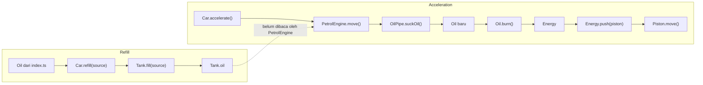
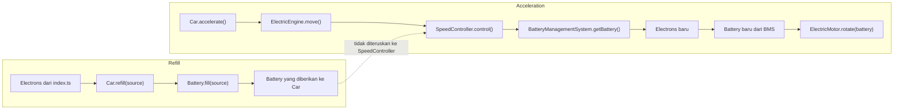

# Visualisasi Aliran Data

Diagram berikut mengikuti alur yang benar-benar dijalankan oleh
[`index.ts`](./index.ts). Garis putus-putus menandai data atau objek yang
terhubung secara konsep, tetapi belum digunakan oleh implementasi saat ini.

## Mobil bensin

`index.ts` mengirim objek `Oil` ke `Car.refill()`, lalu `Tank` menyimpannya.
Saat akselerasi, `PetrolEngine.move()` meminta `OilPipe` membuat objek `Oil`
baru. Jadi, pada implementasi sekarang, mesin belum menggunakan isi `Tank`.

## Mobil listrik

`Car.refill()` mengisi `Battery` yang diberikan kepada `Car`. Namun, ketika
akselerasi, `SpeedController` meminta baterai baru dari
`BatteryManagementSystem`; baterai yang sudah diisi melalui `Car` belum
digunakan oleh jalur tersebut.

## Ringkasan aliran

| Aksi | Sumber data | Penerima atau pemroses | Hasil |
| --- | --- | --- | --- |
| Refill mobil bensin | `Oil` dari `index.ts` | `Car` → `Tank` | `Oil` disimpan di `Tank`. |
| Akselerasi mobil bensin | `Oil` baru dari `OilPipe` | `PetrolEngine` → `Energy` → `Piston` | `Piston.move()` dipanggil. |
| Refill mobil listrik | `Electrons` dari `index.ts` | `Car` → `Battery` | Sumber disimpan di `Battery` milik `Car`. |
| Akselerasi mobil listrik | `Battery` baru dari BMS | `ElectricEngine` → `SpeedController` → `ElectricMotor` | `ElectricMotor.rotate()` dipanggil. |

Diagram ini juga memperlihatkan dua sambungan yang belum selesai: `Tank` belum
menyuplai `PetrolEngine`, dan baterai yang diisi oleh `Car` belum dipakai saat
akselerasi listrik.
